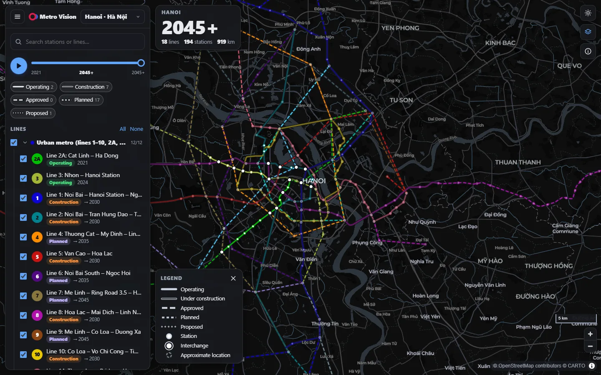
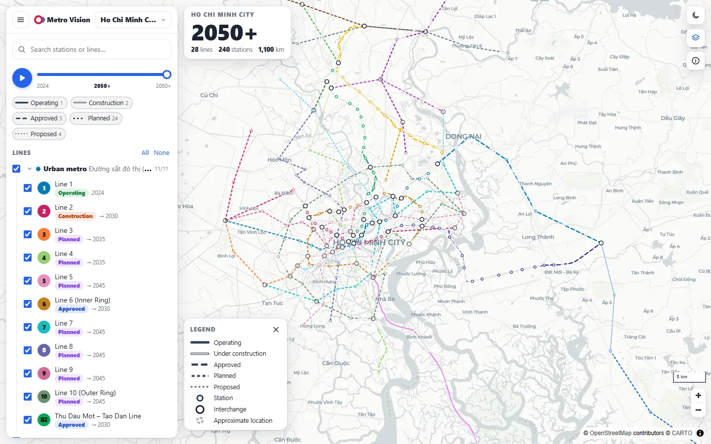
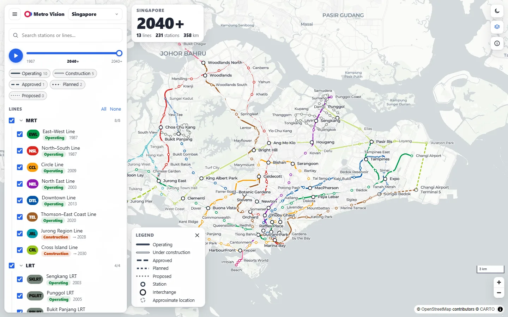
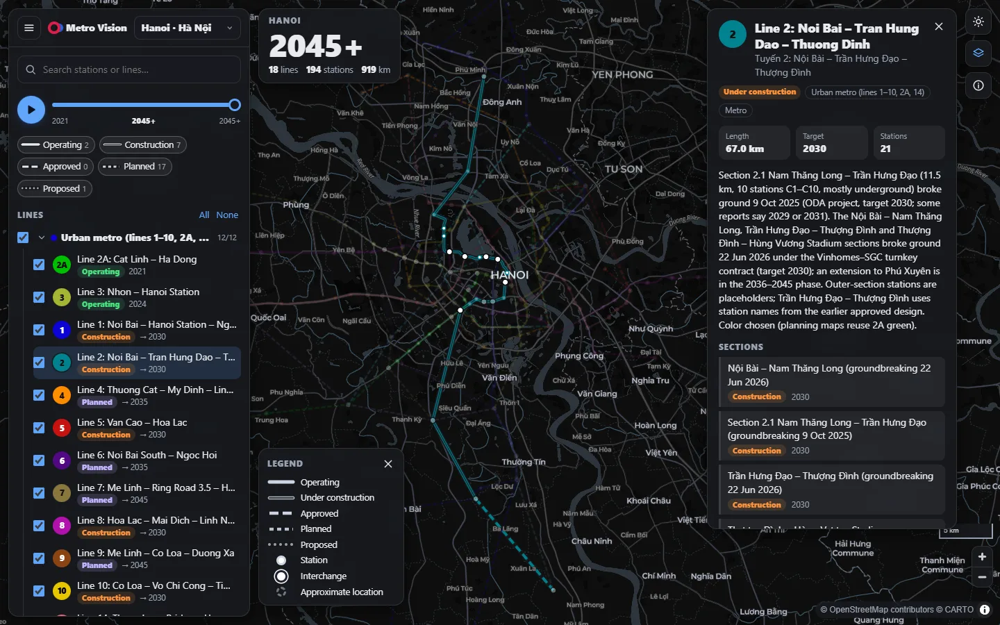

# Metro Vision

Interactive, data-driven map of current and future urban rail networks: **Hanoi, Ho Chi Minh City, Tokyo and Singapore**.
See what runs today, what is being built, and what is planned, and watch the network grow year by year.

React + TypeScript + Vite + MapLibre GL, on a keyless CARTO/OpenStreetMap basemap.



## Watch the network grow

Press **Play** (or drag the timeline) and the map redraws year by year, with live line, station and km counts.
Lines that do not exist yet in the selected year fade out of the sidebar.

<p align="center">
  
</p>

| Hanoi in 2030 | Hanoi in 2045+ |
|---|---|
|  |  |

## Four cities

| Tokyo (dark) | Ho Chi Minh City (light) |
|---|---|
|  |  |
| **Singapore (light)** | **Mobile** |
|  |  |

## Line and station details

Click a line in the sidebar or on the map, or search for any station, to open its detail card:
length, target year, sections with their own status, interchanges, and sources.

| Line card (Hanoi Line 2) | Station card (Shinjuku, Tokyo) |
|---|---|
|  |  |

## Features

- City switcher, light/dark basemap (follows your system theme, toggle in the top-right)
- Group tree with checkboxes (Tokyo: JR > JR East / Shinkansen, Subway > Tokyo Metro / Toei / planned)
- Status filters: operating / under construction / approved / planned / proposed, each drawn differently
- Timeline slider with Play that animates the network growing year by year, with live line/station/km stats
- Station & line search (diacritics-insensitive), line and station detail cards with sources
- Planned stations without official coordinates are drawn faded as "approximate location"
- Drag a `.geojson` / `.kml` / city `.json` onto the map to preview it over the current city
- Responsive: sidebar becomes a bottom sheet on phones

## Quick start

```bash
npm install
npm run dev        # http://localhost:5173/#hanoi  (#hcmc, #tokyo, #singapore)
npm run validate   # check every city file against the data contract
npm run build
```

## Adding / updating cities

**Read [docs/IMPORTING.md](docs/IMPORTING.md)**: updating the existing maps, adding cities from OpenStreetMap,
drawing lines in geojson.io / Google My Maps, `base` fan versions of a city, export/round-trip, and scaling guidance.

```bash
npm run import -- --new da-nang --name "Da Nang" --center 108.21,16.06   # scaffold cities/da-nang/
npm run import -- da-nang --dry                                          # build + validate, write nothing
npm run import -- da-nang                                                # write public/data + cities.json
npm run data:hanoi                                                       # rebuild a hand-curated city
```

## Data

Nothing city-specific is in the React code. Everything comes from `public/data/*.json`
(contract: [src/types.ts](src/types.ts), rules: [DATA.md](DATA.md)). Each city is generated by scripts:

| City | Regenerate | Notes |
|---|---|---|
| Hanoi | `npm run data:hanoi` | [research/hanoi.md](research/hanoi.md) |
| HCMC | `npm run data:hcmc` | [research/hcmc.md](research/hcmc.md) |
| Tokyo | `npm run data:tokyo` | [research/tokyo.md](research/tokyo.md) |
| Singapore | `npm run import -- singapore` (importer, [cities/singapore/](cities/singapore/)) | [research/singapore.md](research/singapore.md) |

Curated line tables live in each `scripts/<city>/` folder; operating track geometry comes from OpenStreetMap (Overpass).
Planned stations without official coordinates are marked `approx` and drawn faded.

## Project layout

```
src/            React app (map, sidebar, search, detail cards, file-drop importer)
public/data/    One JSON file per city + cities.json index (what the app renders)
scripts/        Per-city build scripts and the generic OSM importer
cities/         Importer configs for OSM-sourced cities
research/       Source notes behind each city's data
skills/         Claude skills for researching, quizzing and designing metro networks
docs/           Import guide and README screenshots
```

---

Map data © OpenStreetMap contributors (ODbL), basemap © CARTO.
